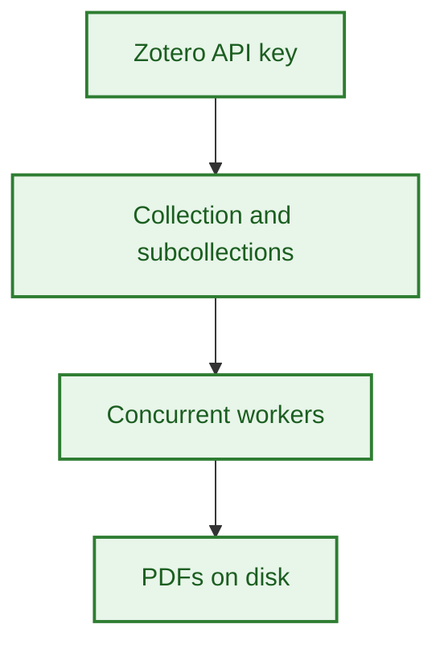
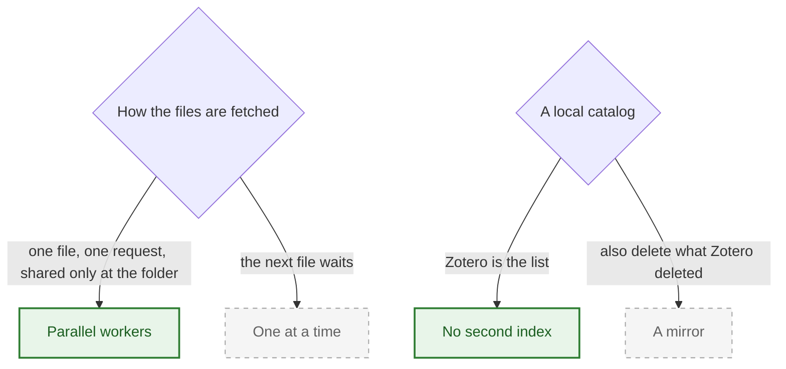

Gotero is an open-source Go client for interacting with the Zotero API . It enables users to fetch Zotero collections and download PDFs concurrently, making it easy to automate and manage research libraries programmatically.

## System design

How a request or a run moves through the code, then the choices behind that shape. In the decision charts, a **solid** box is the route this repo takes and a **dashed** box is the alternative it turns down; the edge label is the tradeoff.

### A collection of PDFs

The CLI takes a collection, including subcollections, and an output directory. Workers download in parallel. Each file is one request. Zotero stays the source of truth.

### Parallel, and no second index

One-at-a-time spends the time on round trips. The run this was pointed at pulled 5,000-plus documents and raised throughput 65% against that. Gotero does not keep its own index, and it does not delete a file Zotero removed.

Longer write-up: [aamogh.vercel.app/projects/gotero](https://aamogh.vercel.app/projects/gotero.html)
